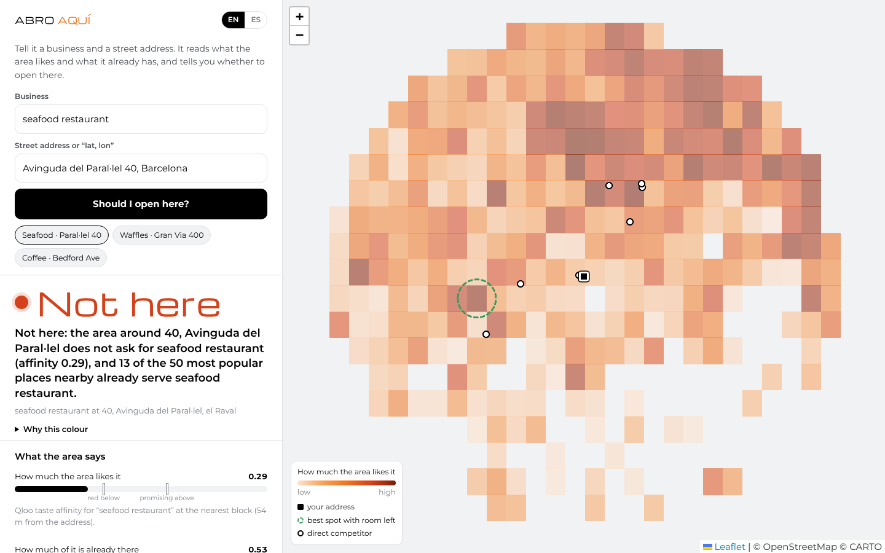

# Abro Aquí: *should I open here?*



A small-business owner is about to sign a lease. Abro Aquí tells them, with reasons, whether **this concept** works at **this street address**, in about 20 seconds and before they spend 50,000–200,000 € finding out.

Type `seafood restaurant` and `Avinguda del Paral·lel 40, Barcelona`. You get:

- **A verdict**: Not here, Hard, Promising, or No data. The exact rule that produced it is one click away.
- **What the area says**: how much the area likes the concept (Qloo taste affinity at the nearest block) and how much of it is already on offer, drawn on two gauges with the rule's thresholds.
- **A taste heat map** of the concept around the address, block by block, with the **best nearby spot that still has room**.
- **The real competitors** within 700 m, with rating, price level and distance.
- **The gap**: parts of your idea nobody nearby offers (for example "waffles").
- **The area**: among the 50 most popular places within 500 m, what they serve, who goes and when.
- **What to do**: positioning, opening hours and where to move.
- **What Qloo cannot see**: foot traffic, rent and income. The owner answers these three, and only then does "Promising" become a green light.
- **"What if…?" chat**: "What if I ignore Puertecillo?", "What if I move 300 m?". The agent re-runs the tools and recomputes the verdict.
- **"Without Qloo"**: the same question answered by the language model alone, so you can see what it makes up.
- **"How I know"**: every API call behind the report, without the key.

Built for the [Qloo Agentic Hackathon](https://qloo.devpost.com/) and the [Nebius x NVIDIA Global AI Hackathon](https://nebiusglobalaihackathon.devpost.com/) (October 2026) by [MarketingAiSales](https://marketingaisales.com).

## Why it only works with Qloo

The verdict is computed from Qloo signals. Without them, a language model guesses the neighbourhood and invents competitors (see the "Without Qloo" tab).

| Qloo call | What we take from it |
| --- | --- |
| `GET /v2/tags` (genre, category and specialty-dish types) | candidate tags for each part of the concept, scored by word overlap |
| `GET /v2/insights?filter.type=urn:heatmap&filter.location=POINT(lon lat)&filter.location.radius=1500&signal.interests.tags=<genre tag>` | affinity, affinity rank and popularity (supply) per block; nearest block and best block with room left |
| `GET /v2/insights?filter.type=urn:entity:place&filter.location=…&filter.location.radius=700&filter.tags=<category or dish tag>` | direct competitors: name, `business_rating`, `price_level`, coordinates, `is_closed` |
| `GET /v2/insights?filter.type=urn:entity:place&filter.location=…&filter.location.radius=500&take=50` | the 50 most popular places nearby; their cuisine, category, customer-identity and time-of-day tags make the area profile |
| `GET /v2/insights?…&filter.location.radius=5000&take=1` | checks whether a tag is actually used nearby before trusting an empty competitor list |

Everything Qloo returns is aggregated and about places. The key stays on the server, and responses are cached for 24 hours.

## How the verdict is decided

The verdict comes from deterministic code (`src/verdict.js`), specified in [`specs/01-verdict.md`](specs/01-verdict.md). The language model explains the verdict; it never decides it.

1. fewer than 50 heat-map blocks → **No data**
2. affinity < 0.35 → **Not here** (the area does not ask for this)
3. supply ≥ 0.80 → **Hard** (saturated)
4. affinity ≥ 0.60 and supply ≤ 0.60 → **Promising** (appetite without offer)
5. otherwise → **Hard**. Two competitors rated 4.5 or more within 400 m move the verdict down one level.

There is no automatic green, because Qloo measures taste and offer, not foot traffic, rent or income.

### Two real Barcelona cases (recorded 26-Oct-2026)

Both businesses below closed. We do not claim the tool would have predicted it: a place that lasted ten years closed for reasons no taste data can see. What we show is what the data says *today* about opening the same concept at the same address.

| Case | What Qloo says | Verdict |
| --- | --- | --- |
| Seafood restaurant, Av. del Paral·lel 40 | affinity **0.29** at the nearest block (54 m); 7 seafood restaurants within 700 m; **13 of the 50** most popular places within 500 m already serve seafood; the area is busiest in the evening and late at night, with tapas and bars | **Not here** |
| Waffles and ice cream, Gran Via 400 (corner of Entença) | affinity **0.52**, supply 0.49; **7 ice-cream shops** within 700 m (Gelatomania 4.8★ at 356 m); **no waffle place** within 700 m; a block **275 m away** scores 0.92 | **Hard**, with "waffles" as the gap and a better spot nearby |

## NVIDIA Nemotron on Nebius Token Factory

Three models, one OpenAI-compatible endpoint (`https://api.tokenfactory.nebius.com/v1/`), each picked for its job:

| Task | Model | Why |
| --- | --- | --- |
| Turn a free-text concept in any language into English parts Qloo can match ("gofres y helados" → `["waffles","ice cream"]`) | `nvidia/NVIDIA-Nemotron-3-Nano-30B-A3B`, JSON mode | tiny, cheap, 1.5 s |
| "What if…?" chat with **tool calling**: `nearby_competitors`, `analyse_address`, `zone_profile`, `verify_business` | `nvidia/Nemotron-3_5-Lightning` | 0.7 s per tool decision; a question can trigger several calls |
| Write the report from the structured signals, as JSON validated with zod (with one repair round) | `nvidia/nemotron-3-super-120b-a12b` | better grounded prose over a large context |

The orchestrator is about 60 lines with no agent framework. A daily cap on model calls (`LLM_DAILY_CAP`) means the public demo can never spend more than its credits. Without `NEBIUS_API_KEY` the app runs in template mode: the Qloo analysis and the verdict still work.

**Tavily**: when the model proposes a launch partner it calls `verify_business`, a live web search, before naming it.

## Run it

```bash
git clone https://github.com/mktaisales-glitch/abro-aqui && cd abro-aqui
npm install
cp .env.example .env      # QLOO_API_KEY, NEBIUS_API_KEY, TAVILY_API_KEY
npm run dev               # http://localhost:3000
npm test                  # verdict rules + pipeline on the two Barcelona cases (pipeline tests need recorded data)
```

Deploy: `render.yaml` (Render blueprint) or the `Dockerfile`. API: `POST /api/analyze {concept, address, lang, without_qloo}`, `POST /api/chat {id, question}`, `POST /api/compare {id, address}`, `GET /api/health`.

Offline replay: `OFFLINE=1` serves only recorded responses (`scripts/plan.js` lists missing calls, `scripts/load.js` loads recordings), which is how the tests run without network.

## Limits and failure modes

- Qloo measures taste and offer, not foot traffic, rent, income or licences. Every report says so.
- Coverage is dense in large cities (Barcelona, New York, San Francisco and London tested: 290–400 blocks within 1.5 km) and thin elsewhere, which gives **No data**.
- Exotic concepts may not map to a Qloo tag. The tool says so and suggests a simpler word. "How I know" shows which tag was used.
- Geocoding uses OpenStreetMap Nominatim. You can also type "lat, lon".
- The demo allows 30 analyses per IP per day and 600 model calls per day in total.

## Responsible use

Abro Aquí decides about a **place**, never about a **person**. No personal data goes into any request. Affinities are described as "the area", never as "the people who live here". Customer-identity labels that touch protected attributes are filtered out of the audience panel. It must not be used for housing, employment or credit decisions. See [`specs/05-safe-use.md`](specs/05-safe-use.md).

## Layout

```
specs/       spec-driven: verdict rules, tools, agent, UI, safe use (written before the code)
src/         http.js (cache, trace) · qloo.js · tools.js · verdict.js · llm.js · agent.js · server.js
public/      one-page UI (Leaflet and fonts self-hosted, no build step)
tests/       verdict rules on real recorded signals; end-to-end pipeline on recorded data
FEEDBACK.md  notes for Nebius / NVIDIA and for Qloo
```

MIT © 2026 MarketingAiSales
