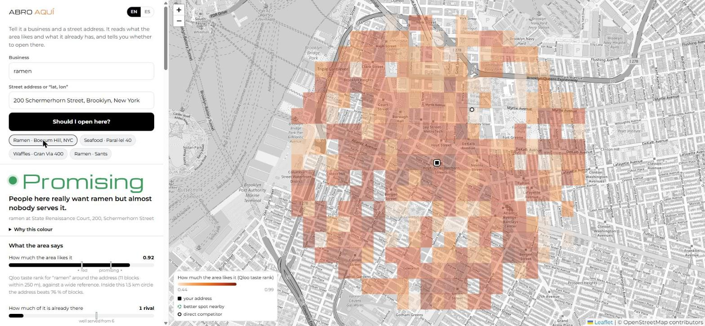
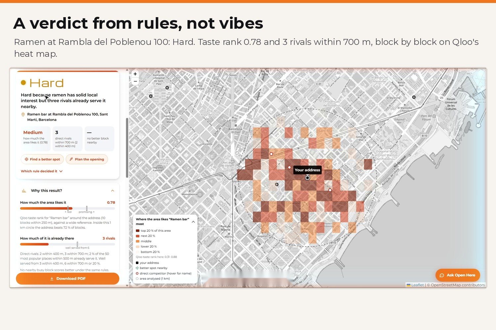
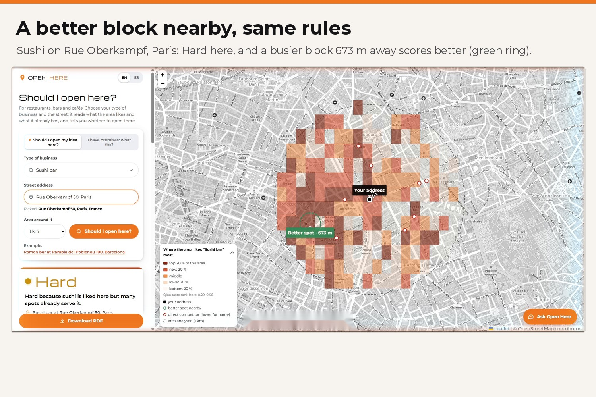
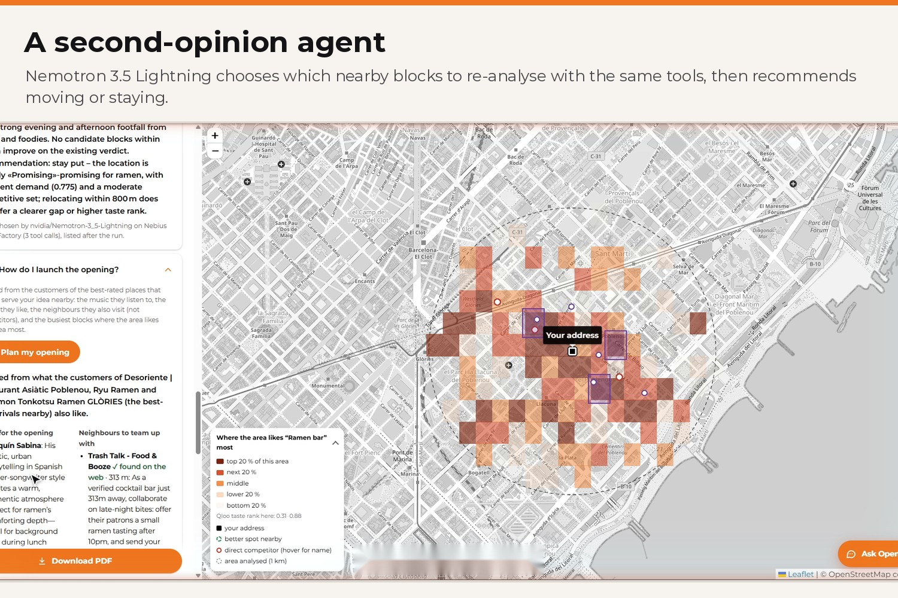
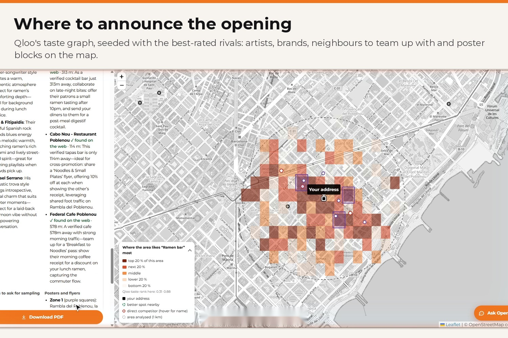
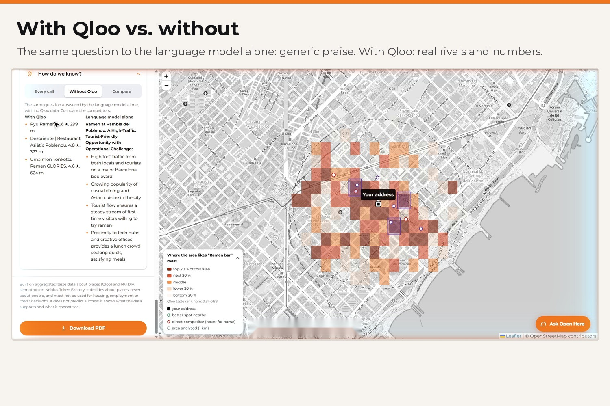
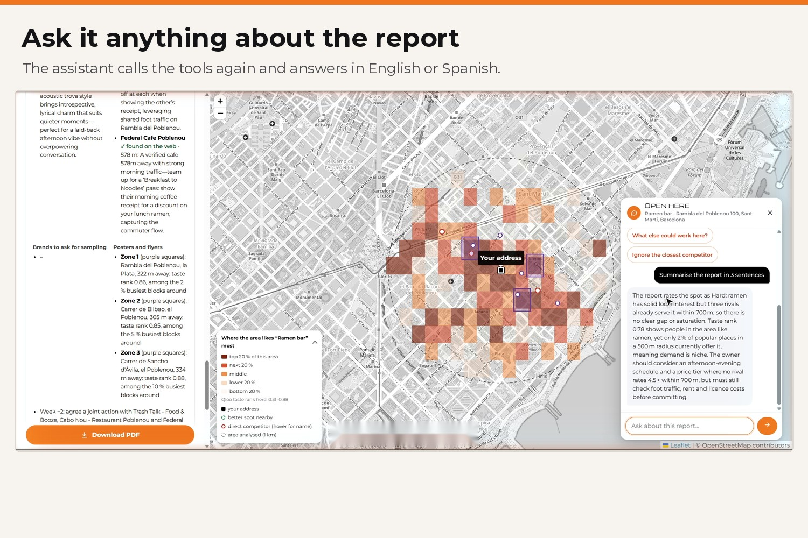
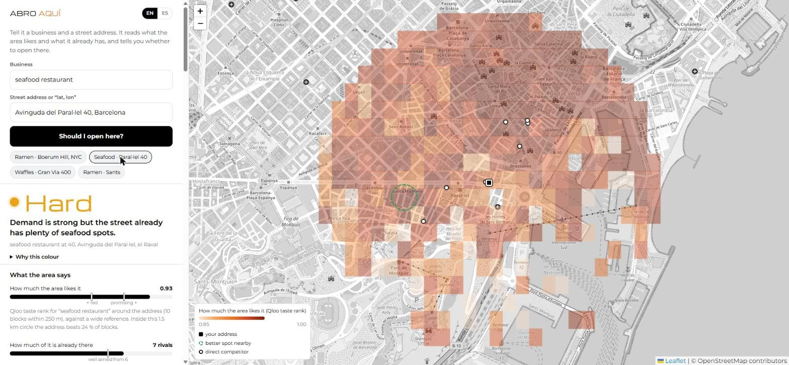

# Open Here: *should I open my restaurant here?*

**Live demo: https://abro-aqui.onrender.com** (free hosting: the first visit after a quiet spell can take up to a minute)

*(The repo and the URL keep the project's first, Spanish name: "abro aquí" = "I open here".)*



For restaurants, bars and cafés. An owner is about to sign a lease. Open Here shows them, with reasons, what the data says about **this concept** at **this street address** before they commit the money: opening a ~100 m² restaurant in Barcelona's Eixample takes at least 400,000 € ([Ara, 23 Sep 2025](https://es.ara.cat/comer/odisea-financiera-burocratica-abrir-restaurante-nuevo-comienza-400-000-euros_1_5505805.html)): how much the area likes it, how much of it is already there, and a better block nearby if there is one.

Two questions, same rules: **"should I open my idea here?"** (a concept and an address) and **"I have a place: which food business fits?"** (an address; 15 restaurant, bar and café concepts ranked; see [`specs/07-explore.md`](specs/07-explore.md)). The owner picks the area around the address: 500 m, 1 km (default), 1.5 km or 2 km.

Type `seafood restaurant` and `Avinguda del Paral·lel 40, Barcelona`. You get:

- **A verdict**: Not here, Hard, Promising, or No data. The exact rule that produced it is one click away.
- **What the area says**: how much the area likes the concept (Qloo `affinity_rank` around the address) and how much of it is already there (real rivals within 400 and 700 m, and the share of popular places that already serve it), drawn on two gauges with the rule's thresholds.
- **A taste heat map** of the concept around the address, block by block, with a **better spot nearby** when a busy block comes out better under the same rules (taste measured the same way, within 250 m): a better verdict, or the same verdict with clearly more taste and fewer rivals. The page says which, e.g. "same verdict (Hard), 1 rival within 700 m instead of 3, the area likes it more (0.82 vs 0.78)".
- **The real competitors** within 700 m, with rating, price level and distance.
- **The gap**: parts of your idea nobody nearby offers, and parts Qloo cannot measure there (said as such, never passed off as a gap).
- **The area**: among the 50 most popular places within 500 m, what they serve, who goes and when.
- **What to do**: positioning, opening hours and where to move.
- **What Qloo cannot see**: foot traffic, rent and income. The owner answers these three, and only then does "Promising" become a green light.
- **Second opinion agent**: one goal ("find me a better spot"); code finds the candidate blocks (the green ring is computed by code), and Nemotron 3.5 Lightning, given the goal, the current verdict and the tools, chooses which of them to re-analyse with the same rules and recommends moving or staying; numbers in its answer that no tool returned are dropped by code; the page lists each step with its time.
- **Launch plan, "where do I announce it?"** (screenshots: [agent steps](docs/live-agent-steps.jpg), [launch plan at the better spot](docs/live-launch-plan.jpg), [what fits at Fuencarral 100, Madrid](docs/live-what-fits-madrid.jpg)): learned from the customers of the best-rated rivals nearby, through Qloo's taste graph: music for the opening, brands to ask for sampling, neighbours to team up with (not competitors, checked on the web) and the poster zones on the map, with a 4-week plan. The model chooses among Qloo's candidates; code drops any name it invents ([`specs/04-launch.md`](specs/04-launch.md)).
- **"What if…?" chat**: "What if I ignore Puertecillo?", "What about Carrer de Blai?". The agent calls the tools again and recomputes the verdict.
- **"Without Qloo"**: the same question answered by the language model alone, so you can see what it makes up.
- **Downloadable report (PDF)**: the address, verdict, facts, a drawn taste map, competitors, the reasons, what to check before signing, and the agent's answer and opening plan when they were run; built from the analysis already in memory, no new API calls ([`specs/08-report.md`](specs/08-report.md)).
- **"How I know"**: every Qloo, geocoding and Tavily call behind the report (failed ones too) and every model call with its time, without the key.

Built in October 2026 by [MarketingAiSales](https://marketingaisales.com).

## Thirty-second tour

| | |
| --- | --- |
| [](docs/img/01-result.jpg) | [](docs/img/02-paris2.jpg) |
| [](docs/img/03-launch1.jpg) | [](docs/img/04-launch2.jpg) |
| [](docs/img/05-noq2.jpg) | [](docs/img/06-chat2.jpg) |

**Demo video (2:55):** https://youtu.be/P8UAG_s8MZY

## Why it only works with Qloo

The verdict is computed from Qloo signals. Without them, a language model guesses the neighbourhood and invents competitors (see the "Without Qloo" tab).

| Qloo call | What we take from it |
| --- | --- |
| `GET /v2/tags` (genre, category and specialty-dish types) | candidate tags for each part of the concept, scored by word overlap |
| `GET /v2/insights?filter.type=urn:heatmap&filter.location=POINT(lon lat)&filter.location.radius=<area picked, default 1000>&signal.interests.tags=<genre tag>` | affinity, affinity rank and popularity (supply) per block, within the area the owner picks (500 m–2 km, 1 km by default); nearest block and best block with room left |
| `GET /v2/insights?filter.type=urn:entity:place&filter.location=…&filter.location.radius=700&filter.tags=<category or dish tag>` | direct competitors: name, `business_rating`, `price_level`, coordinates, `is_closed` |
| `GET /v2/insights?filter.type=urn:entity:place&filter.location=…&filter.location.radius=500&take=50` | the 50 most popular places nearby; their cuisine, category, customer-identity and time-of-day tags make the area profile |
| `GET /v2/insights?…&filter.location.radius=5000&take=1` | checks whether a tag is actually used nearby before trusting an empty competitor list |
| `GET /v2/insights?filter.type=urn:entity:artist` / `urn:entity:brand` / `urn:entity:place` with `signal.interests.entities=<best-rated rivals>` | launch plan: what the customers of the places that already win here also like (music, brands, nearby non-competing places) |

Everything Qloo returns is aggregated and about places. The key stays on the server, and responses are cached for 24 hours.

## How the verdict is decided

The verdict comes from deterministic code (`src/verdict.js`), specified in [`specs/01-verdict.md`](specs/01-verdict.md). The language model explains the verdict; it never decides it.

How we read Qloo's heat map: `affinity` and `popularity` are ranks **inside** the 1.5 km circle (evenly spread from 0 to 1), so they never decide on their own. Demand is `affinity_rank`, averaged over the blocks within 250 m. Offer is counted with real places.

1. too few heat-map blocks for the area picked → **No data** (the minimum scales with the circle's area: 10 blocks for 500 m, 22 for 1 km, 50 for 1.5 km, 89 for 2 km; `minCoverageFor` in `src/agent.js`)
2. demand < 0.75 → **Not here** (the area's taste leans elsewhere)
3. well served (≥ 3 rivals within 400 m, ≥ 6 within 700 m, or ≥ 20 % of the popular places nearby already serve it) → **Hard**
4. demand ≥ 0.85 and almost no offer (≤ 1 rival within 700 m) → **Promising**
5. otherwise → **Hard**. Two rivals rated 4.5 or more within 400 m turn Promising into Hard.

There is no automatic green, because Qloo measures taste and offer, not foot traffic, rent or income.

### Two real Barcelona cases (recorded 26–27 Oct 2026, confirmed live on 28 Oct)

Both businesses below closed. We do not claim the tool would have predicted it: the seafood restaurant lasted ten years, and businesses close for reasons no taste data can see. What we show is what the data says *today* about opening the same concept at the same address.

| Case | What Qloo says | Verdict |
| --- | --- | --- |
| Seafood restaurant, Av. del Paral·lel 40 | the area **loves** seafood (demand 0.93), but it is **well served**: Puertecillo Paral·lel (4.4★) is 26 m away, 7 seafood restaurants within 700 m, and **13 of the 50** most popular places within 500 m already serve seafood. A busy block about 390 m away comes out with the same verdict but likes it more (0.97 vs 0.93) and has 3 rivals within 700 m instead of 7 | **Hard**, with a better spot nearby |
| Waffles and ice cream, Gran Via 400 (corner of Entença) | demand for ice cream 0.85; **7 ice-cream shops** within 700 m (Gelatomania 4.8★ at 356 m). Waffles **cannot be measured**: Qloo has no waffle-tagged place within 5 km, and the report says so instead of calling it a gap | **Hard** |



### The other verdicts, live on the public demo (28 Oct 2026)

| Case | What Qloo says | Verdict |
| --- | --- | --- |
| Ramen, 200 Schermerhorn Street, Brooklyn (Boerum Hill) | taste rank 0.92, **one** rival within 700 m, 1 of 50 popular places serves it. The report: "People here really want ramen but almost no one serves it." | **Promising** (green only after foot traffic, rent and income are checked) |
| Ramen, Carrer de Sants 100, Barcelona | taste rank 0.57, below the 0.75 line: the area's taste leans elsewhere | **Not here** |

On the Paral·lel case, the language model alone (same Nemotron 3 Super, no Qloo) answered: *"Opening a seafood restaurant at Avinguda del Paral·lel 40 is promising due to high foot traffic and tourism density."* That is the gap Qloo closes.

## NVIDIA Nemotron on Nebius Token Factory

Three models, one OpenAI-compatible endpoint (`https://api.tokenfactory.nebius.com/v1/`), each picked for its job:

| Task | Model | Why |
| --- | --- | --- |
| Turn a free-text concept in any language into English parts Qloo can match ("gofres y helados" → `["waffles","ice cream"]`) | `nvidia/NVIDIA-Nemotron-3-Nano-30B-A3B`, JSON mode | tiny, cheap, 1.5 s |
| "What if…?" chat with **tool calling**: `nearby_competitors`, `analyse_address`, `zone_profile`, `verify_business` | `nvidia/Nemotron-3_5-Lightning` | 0.7 s per tool decision in our tests; a question can trigger several calls |
| Write the report from the structured signals, and choose the launch plan among Qloo's candidates, as JSON validated with zod (with one repair round) | `nvidia/nemotron-3-super-120b-a12b` | better grounded prose over a large context |

No agent framework: the tool loop is a short function in `src/llm.js`. A daily cap on model calls (`LLM_DAILY_CAP`, repair rounds included) and a 25 s timeout per call keep the public demo within its credits. Without `NEBIUS_API_KEY` the app runs in template mode (plain-language report in English or Spanish): the Qloo analysis and the verdict still work.

**Tavily**: every partner the writer proposes and every neighbour in the launch plan is searched on the live web before it is shown, and only kept if its name appears in a result title or URL ("✓ found on the web"). In the chat, the model decides when to call `verify_business` itself.

## Run it

```bash
git clone https://github.com/mktaisales-glitch/abro-aqui && cd abro-aqui
npm install
cp .env.example .env      # QLOO_API_KEY, NEBIUS_API_KEY, TAVILY_API_KEY
npm run dev               # http://localhost:3000
npm test                  # 58 tests (52 run on a public clone; 6 replay recorded Qloo data that is not published): HTTP layer and security headers, PDF report, verdict rules, launch plan (Qloo and model mocks), JSON extraction, Qloo rate limiting, PII scrub;
                          # 6 of them replay the recorded Barcelona cases
                          # from fixtures/demo.sqlite, which is not published (Qloo terms), so they skip on a fresh clone (52 of 58 run)
```

Deploy: `render.yaml` (Render blueprint) or the `Dockerfile`. API: `POST /api/analyze {concept, address, lang, without_qloo, coords?}` (`concept` is a listed concept id, label or synonym, e.g. "hamburguesería" → burger; free text still goes to the resolver; `coords {lat, lon}` comes from a picked address suggestion), `GET /api/concepts` (the 15 concepts with English and Spanish labels and synonyms), `GET /api/geocode/suggest?q=&lang=` (address suggestions from Photon, at most 5), `POST /api/chat {id, question, lang}`, `POST /api/scout {id, lang}`, `POST /api/launch {id, lang, at}`, `POST /api/explore {address, radius, coords?}`, `POST /api/compare {id, address}`, `GET /api/health`. `radius` is 500, 1000 (default), 1500 or 2000.

Geocoding: Nominatim, then Photon; when the address names a city, the first result in that city wins ("Avenida del Paralelo 4, Barcelona" is not Almussafes), Spanish street names typed for Barcelona are retried with the Catalan ones (Avenida del Paralelo → Avinguda del Paral·lel, Calle → Carrer, Gran Vía → Gran Via de les Corts Catalanes, Paseo de Gracia → Passeig de Gràcia, Diagonal), and a result outside the named city is flagged so the page asks "Is this the place?".

Offline replay: `OFFLINE=1` serves only recorded responses (`scripts/plan.js` lists every missing call, `scripts/load.js` loads recordings), which is how the tests run without network. Locally (SQLite cache), if a live call fails the server falls back to recordings when they exist; the public demo has no recordings (Qloo responses are not published), so a failed call shows up as an error in "How I know".

## Limits and failure modes

- Qloo measures taste and offer, not foot traffic, rent, income or licences. Every report says so.
- Coverage is dense in large cities (Barcelona and Brooklyn checked: 300–400 blocks within 1.5 km) and thin elsewhere, which gives **No data**.
- `affinity_rank` compares a block with a wide reference that Qloo does not document in detail; dense city centres score high for many concepts, so offer often decides between Hard and Promising.
- Exotic concepts may not map to a Qloo tag. The tool says so and suggests a simpler word. "How I know" shows which tag was used.
- Geocoding uses OpenStreetMap Nominatim. You can also type "lat, lon".
- The demo allows per IP and day: 30 analyses, 30 comparisons, 120 chat questions, 15 scout runs, 15 launch plans, 3 "what fits here" runs, 400 address suggestions and 250 model calls; 2,500 model calls per day in total (`LLM_DAILY_CAP_PER_IP`, `LLM_DAILY_CAP`). When the assistant's share is used up, the chat says so in plain words ("today's free limit for the assistant is used up on this demo"). Every request has a 60 s ceiling; after 3 model failures in a row the model is skipped for 5 minutes and the templates answer. Limits and caches live in memory and reset when the server restarts. On the free hosting plan the first visit after a quiet spell can take up to a minute.

## Security

Keys stay on the server (Qloo's travels in a header, never in a URL, so "How I know" cannot show it). Security headers (CSP, no framing, nosniff, origin-only referrer: OpenStreetMap tiles require one). All model and third-party text is escaped before it reaches the page. Web search results never go back to the model (only found / not found and the link), the chat's tools only work within 2–3 km of the analysed address and have a budget of 6 calls per answer, so a prompt injection cannot run up costs. E-mails, phones, Spanish ID numbers and IBANs are removed before any model or search call. `npm audit --omit=dev`: 0 vulnerabilities (28 Oct 2026).

## Responsible use

Open Here decides about a **place**, never about a **person**. E-mails and phone numbers typed into the app are removed before any model or search call (`src/safe.js`, tested). Affinities are described as "the area", never as "the people who live here". Some customer-identity labels that touch protected attributes (religion, ethnicity, sexuality, disability, age groups) are filtered out of the audience panel. In the launch plan a neighbour is never excluded for who its customers are; only settings where a commercial promotion is out of place (clinics, schools, funeral homes, police) are skipped. It must not be used for housing, employment or credit decisions. See [`specs/05-safe-use.md`](specs/05-safe-use.md).

**Coverage bias.** Qloo knows more about busy, central, touristic areas than about quiet or lower-income ones. Thin areas get **No data** rather than a verdict, which is honest, but it means the tool is most useful where data already exists; we say so instead of filling the gap with guesses.

## Layout

```
specs/       spec-driven: 01 verdict (v2 after review) · 02 tools · 03 models and agents · 04 launch plan · 05 safe use · 06 UI · 07 what fits here + analysed area
src/         http.js (cache, trace) · qloo.js · tools.js · verdict.js · llm.js · agent.js (analysis, chat, scout) · launch.js · i18n.js · safe.js · server.js
public/      one-page UI (Leaflet and fonts self-hosted, no build step)
tests/       verdict rules; launch plan against Qloo and Token Factory mocks; end-to-end pipeline on recorded data (local only)
FEEDBACK.md  notes for Nebius / NVIDIA and for Qloo
```

MIT © 2026 MarketingAiSales
